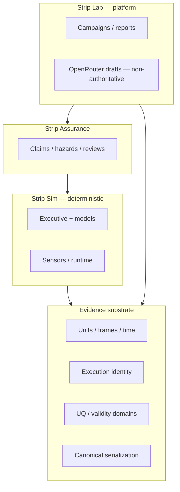
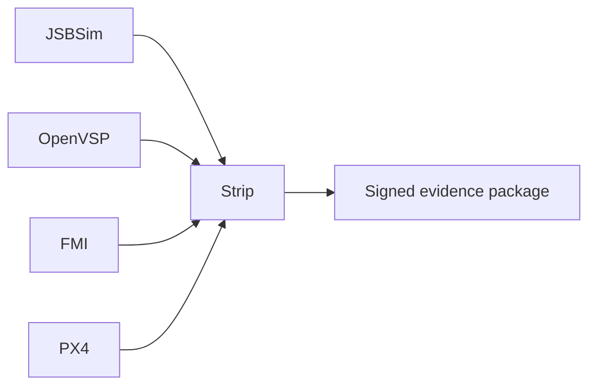

# Architecture

Three planes on one evidence substrate. Simulation never talks to the network; platform orchestration is non-authoritative until assurance seals it.

## Product vs experimental

| Surface | Import path | Status |
|---------|-------------|--------|
| Atmosphere, dynamics, fixed-wing, validation, UAS, assurance | `strip.*` | Product / programme |
| Agent, AeroIR, WorldForge, twin, … | `strip.experimental.*` | Contracts only |

## External evidence producers

Strip owns protocols, digests, disagreement reporting — not clones of those tools.
