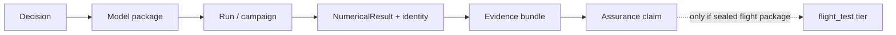

# Onboarding

Goal: green `zig build verify`, one evidence bundle, one campaign scaffold — without mistaking experimental modules for product.

## 1. Toolchain

| Pin | Value |
|-----|-------|
| Zig | `0.16.0` |
| JSBSim | `jsbsim==1.3.1` |
| OpenVSP (optional) | `3.42.0` deb + SHA-256 in [Reproducible build](./reproducible-build) |

## 2. Verify

```sh
cd /home/user/sovereign-physics/strip
python3 -m venv .venv
.venv/bin/pip install --disable-pip-version-check jsbsim==1.3.1
export PATH="$(pwd)/.venv/bin:$PATH"
export JSBSIM_CMD=tools/jsbsim_cmd.sh
zig build verify
```

## 3. Evidence + campaign

```sh
./zig-out/bin/strip-evidence build programs/reference-uas.toml
./zig-out/bin/strip-campaign run campaigns/reference-uas-contingency.toml
```

Inspect `program.evidence/manifest.json` and `campaign.evidence/manifest.json` — both carry `execution_identity` and Ed25519 attestation.

## 4. Mental model



## 5. Do not demo yet

Anything under `strip.experimental.*` is a contract stub. See [EXPERIMENTAL.md](https://github.com/SMC17/strip/blob/main/EXPERIMENTAL.md).
