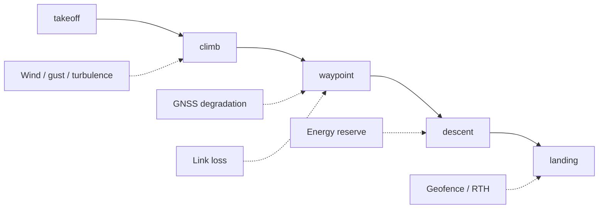

# Reference UAS vertical slice

Month-6 programme: **one vehicle, one envelope, one assurance case**.



## Artefacts

| Artefact | Path |
|----------|------|
| Programme | `programs/reference-uas.toml` |
| Model package | `programs/reference-uas-models.json` |
| Campaign | `campaigns/reference-uas-contingency.toml` |
| Assurance | `fixtures/assurance/link-loss.json` |

## Campaign scale

```sh
# Scaffold (CI default cap)
./zig-out/bin/strip-campaign run campaigns/reference-uas-contingency.toml

# Full 10k SIL Monte Carlo (CI job campaign-10k)
STRIP_CAMPAIGN_RUN_ALL=1 ./zig-out/bin/strip-campaign run campaigns/reference-uas-contingency.toml
```

Exit criteria (Month 6): declared validation envelope, per-variable acceptance metrics, uncertainty budget, benchmark from one command, **no synthetic data labeled as flight evidence**.
