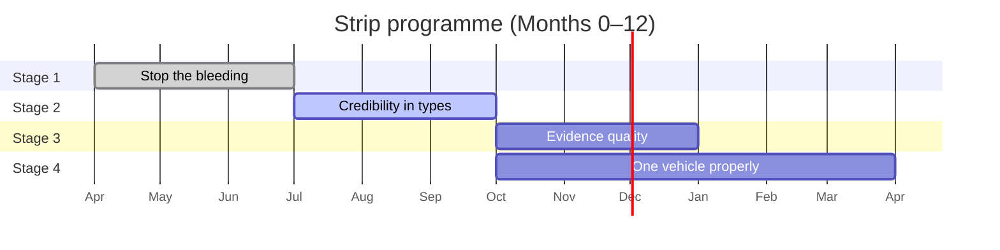

# Roadmap map

Living programme: [`ROADMAP-1.0.md`](https://github.com/SMC17/strip/blob/main/ROADMAP-1.0.md).

## Product wedges (ranked)

1. Strip Verify — CI credibility compiler
2. Evidence compiler — signed packages
3. Certification-delta engine
4. Model credibility passports
5. Validation campaign compiler
6. Flight-test foundry
7. HIL-in-a-box
8. Supplier evidence exchange

Items 3–8 stay **later** until Stage 1 exit is closed and the reference UAS slice has real (not synthetic) validation data for flight tiers.
