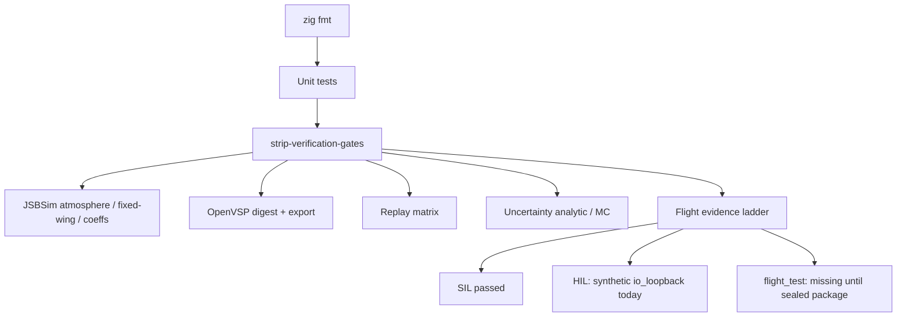

# Verification

`zig build verify` is the local credibility compiler. CI adds multi-arch replay pins, real OpenVSP export, and a 10k campaign job.



## Authoritative outputs

Every `NumericalResult(T)` carries `execution_identity` (`model_id`, `model_version`, optional `content_sha256` / `seed`).

Evidence and campaign manifests include:

```json
"execution_identity": {
  "content_sha256": "sha256:…",
  "seed": 42,
  "campaign_id": "reference-uas-contingency"
}
```

## Schemas

| Schema | Fixture |
|--------|---------|
| `strip.model-package.v1` | `fixtures/schemas/model-package.*.json` |
| `strip.run-manifest.v1` | `fixtures/schemas/run-manifest.*.json` |

## Honest limits

- Signing: Ed25519 CI key / env override — not HSM
- HIL: synthetic loopback, not a physical bench
- Flight: intentionally `missing`
